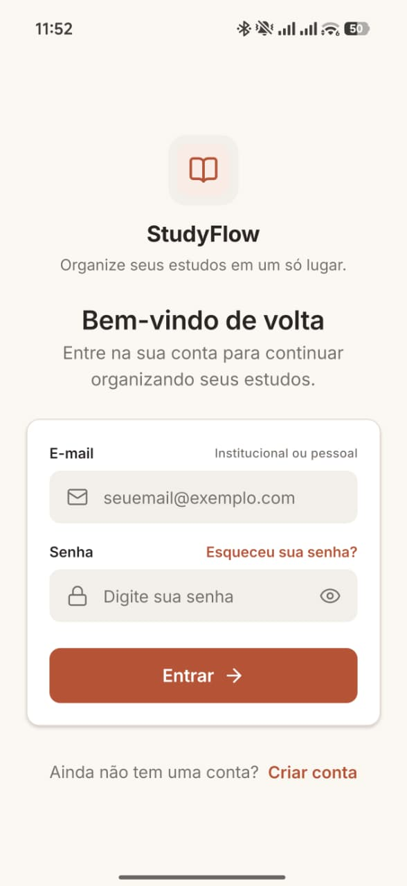
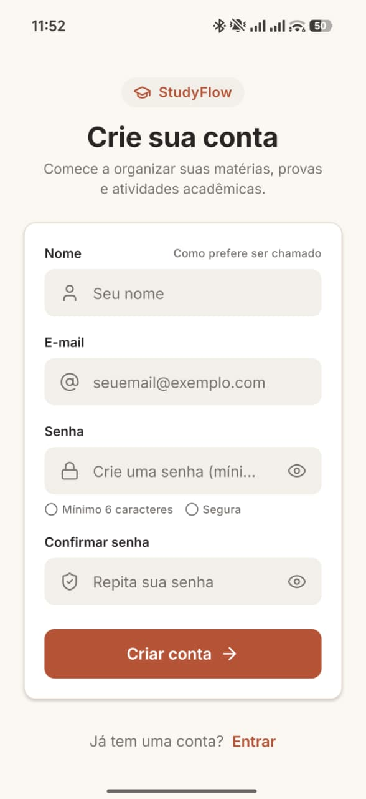
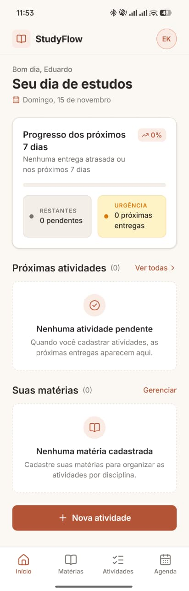
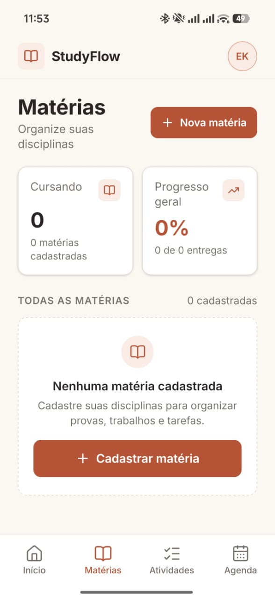
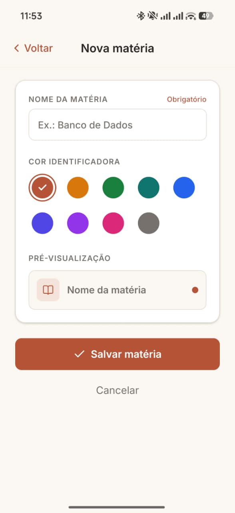
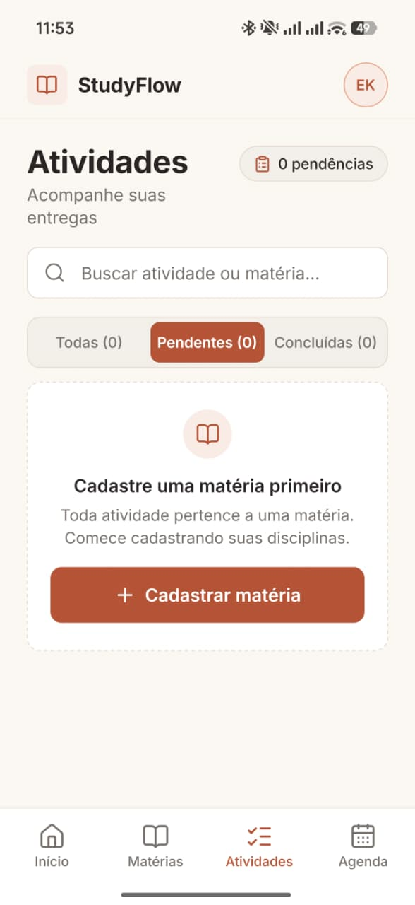
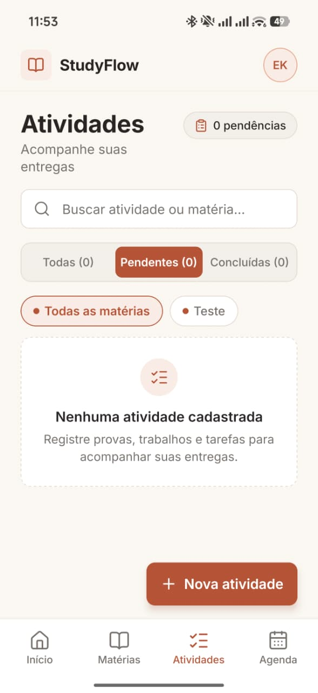
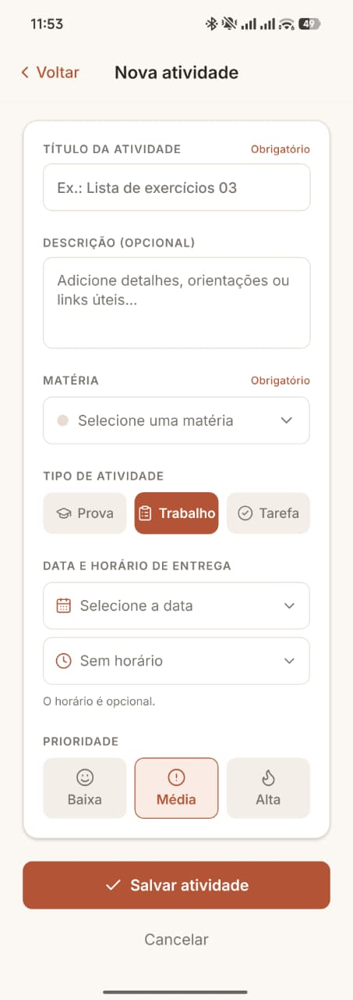
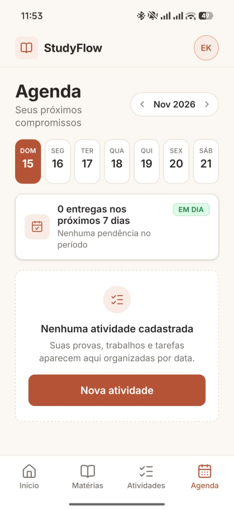

# StudyFlow

**Aluno:** Eduardo Ratki Krautchuk

Organizador acadêmico para estudantes universitários, desenvolvido com React Native, Expo e Firebase. O StudyFlow reúne matérias, provas, trabalhos e tarefas em um só lugar, mostra o que vence primeiro e avisa antes de cada prazo.

## Funcionalidades

- Cadastro e login com e-mail e senha, recuperação de senha por e-mail e sessão que continua ativa ao reabrir o app
- Painel inicial com saudação, progresso dos próximos 7 dias, pendências urgentes, próximas entregas e resumo das matérias
- Cadastro, edição e exclusão de matérias, com cor identificadora e progresso de entregas
- Cadastro, edição, conclusão e exclusão de atividades (prova, trabalho ou tarefa), com prioridade, data e horário
- Busca por título ou matéria, filtros por status e por matéria e ordenação por data
- Agenda semanal com indicação de atrasos, compromissos agrupados por dia e detalhes de cada atividade
- Lembretes locais 1 hora e 5 minutos antes de cada prazo (ou às 08:00 para atividades sem horário)
- Dados salvos na nuvem (Cloud Firestore), separados por usuário

## Telas

| Tela | Função |
|---|---|
| Login | Entrar com e-mail e senha e solicitar redefinição de senha |
| Criar conta | Cadastro com nome, e-mail e senha, com validação dos campos |
| Início | Visão geral do dia: progresso, urgências, próximas atividades e matérias |
| Matérias | Lista de disciplinas com pendências e progresso, além de editar e excluir |
| Nova / Editar matéria | Formulário com nome, cor e pré-visualização |
| Atividades | Lista completa com busca, filtros, ordenação, conclusão, edição e exclusão |
| Nova / Editar atividade | Formulário com título, descrição, matéria, tipo, data, horário e prioridade |
| Agenda | Semana navegável com compromissos por dia e detalhes de cada atividade |

## Capturas de tela

| Login | Criar conta | Início |
|---|---|---|
|  |  |  |

| Matérias | Nova matéria | Atividades (sem matérias) |
|---|---|---|
|  |  |  |

| Atividades (com matéria) | Nova atividade | Agenda |
|---|---|---|
|  |  |  |

**Vídeo de demonstração:** [assistir no Google Drive](https://drive.google.com/drive/folders/1oJt2Tht9x9JSWeSMISP5Rtwpfo7DyJ9w?usp=sharing) recomendado baixar o vídeo para visualizar em melhor definição

## Tecnologias

- [Expo SDK 58](https://docs.expo.dev/) com [Expo Router](https://docs.expo.dev/router/introduction/) para navegação por arquivos
- React Native 0.88 e TypeScript em modo estrito
- Firebase JavaScript SDK: Authentication e Cloud Firestore
- AsyncStorage para manter a sessão de login no dispositivo
- expo-notifications para os lembretes locais
- Lucide (ícones) e fonte Inter
- Estilização com `StyleSheet` e estado com `useState`, `useEffect` e hooks próprios
- pnpm como gerenciador de pacotes

## Requisitos do trabalho

| Requisito | Onde está |
|---|---|
| Expo executável no Expo Go | `pnpm start` abre direto no modo Expo Go |
| Mínimo de 4 telas com navegação | 8 telas com Expo Router, abas inferiores e telas de formulário |
| Componentes reutilizáveis próprios | `src/components` (botões, campos, cards, cabeçalhos, diálogos, calendário) |
| `useState` e `useEffect` | Todas as telas, além de `src/hooks/use-auth.tsx` e `src/hooks/use-study-data.tsx` |
| Listagem com FlatList ou ScrollView | FlatList em Matérias e Atividades, ScrollView em Início e Agenda |
| Formulário com validação | Login, Criar conta, Nova matéria e Nova atividade |
| Estilização com StyleSheet | Todo o app, com cores e tipografia em `src/constants/theme.ts` |
| Bônus: AsyncStorage | Persistência da sessão em `src/services/firebase.native.ts` |
| Bônus: API externa | Firebase Authentication e Cloud Firestore |
| Bônus: recurso nativo do Expo | Notificações locais com `expo-notifications` |

## Estrutura do projeto

```
src/
  app/                    rotas (Expo Router)
    _layout.tsx           fontes, sessão, diálogos e proteção de rotas
    (auth)/               login e criar conta
    (app)/                área logada
      (tabs)/             Início, Matérias, Atividades e Agenda
      subject-form.tsx    criar e editar matéria
      activity-form.tsx   criar e editar atividade
  components/             componentes visuais reutilizáveis
  constants/              tema (cores, espaçamentos, tipografia) e rótulos
  hooks/                  sessão, dados do Firestore, diálogos, conta e lembretes
  services/               Firebase, autenticação, matérias, atividades e notificações
  types/                  tipos de dados
  utils/                  datas, filtros, painel, validações e lembretes
```

Os arquivos `*.native.ts` são usados no Android e no iOS. Os equivalentes sem `.native` são usados na versão web.

## Configuração do Firebase

1. Crie um projeto no [Firebase Console](https://console.firebase.google.com/).
2. Em **Authentication > Sign-in method**, ative **E-mail/senha**.
3. Em **Firestore Database**, crie o banco em **modo de produção** (sugestão de local: `southamerica-east1`).
4. Na aba **Regras** do Firestore, publique regras que:
   - permitam a cada usuário autenticado ler e escrever apenas em `users/{seu uid}/subjects` e `users/{seu uid}/activities`;
   - validem os campos das matérias (`name`, `color`, `createdAt`) e das atividades (`title`, `description`, `subjectId`, `type`, `priority`, `status`, `dueDate`, `dueTime`, `createdAt`, `updatedAt`);
   - bloqueiem qualquer outro caminho do banco.
5. Em **Configurações do projeto > Seus apps**, registre um app **Web** e copie a configuração.
6. Copie `.env.example` para `.env` e preencha:

```
EXPO_PUBLIC_FIREBASE_API_KEY=
EXPO_PUBLIC_FIREBASE_AUTH_DOMAIN=
EXPO_PUBLIC_FIREBASE_PROJECT_ID=
EXPO_PUBLIC_FIREBASE_STORAGE_BUCKET=
EXPO_PUBLIC_FIREBASE_MESSAGING_SENDER_ID=
EXPO_PUBLIC_FIREBASE_APP_ID=
```

O arquivo `.env` está no `.gitignore`. Esses valores são a configuração pública do app web do Firebase, e a segurança dos dados é garantida pelas regras do Firestore. Nunca adicione chaves de conta de serviço ao repositório.

## Como rodar

### Pré-requisitos

- Node.js 20 ou superior
- [pnpm](https://pnpm.io/installation)
- Aplicativo **Expo Go** atualizado no celular ([Android](https://play.google.com/store/apps/details?id=host.exp.exponent) ou [iOS](https://apps.apple.com/app/expo-go/id982107779)), compatível com o SDK 58
- Celular e computador na **mesma rede Wi-Fi**

### Passos

```bash
pnpm install
pnpm start
```

`pnpm start` executa `expo start --go`, que já inicia no modo **Expo Go**. Sem o `--go`, o Expo pode iniciar no modo *development build*, e o QR code não abre no Expo Go (nesse caso, aperte `s` no terminal para alternar).

Escaneie o QR code:

- **Android:** pelo próprio app Expo Go, em *Scan QR code*
- **iOS:** pela câmera do iPhone

Depois de alterar o `.env`, reinicie limpando o cache:

```bash
pnpm start --clear
```

### O celular não conecta?

O Expo Go acessa o servidor de desenvolvimento do computador pela rede local, na **porta 8081**. Se o app fica carregando ou mostra erro de conexão:

1. **Firewall do computador:** é a causa mais comum. Firewalls como `ufw` (Linux), o Firewall do Windows ou o do macOS podem bloquear conexões vindas do celular. Libere a porta 8081 enquanto estiver desenvolvendo. Por exemplo, no Linux com ufw:

   ```bash
   sudo ufw allow 8081/tcp
   ```

   Para fechar de novo depois: `sudo ufw delete allow 8081/tcp`. No Windows, permita o Node.js em redes privadas quando o aviso do Firewall aparecer.

2. **Rede que isola aparelhos:** redes de faculdade, empresa ou públicas costumam impedir que dispositivos se comuniquem. Nesse caso, use o modo túnel, que exige uma conta Expo gratuita:

   ```bash
   pnpm expo login
   pnpm start:tunnel
   ```

3. **Versão do Expo Go:** se aparecer erro de SDK incompatível, atualize o Expo Go pela loja.

### Versão web

```bash
pnpm web
```

Abre em `http://localhost:8081`. As notificações não estão disponíveis no navegador.

## Notificações

O app agenda lembretes locais para cada atividade pendente:

- 1 hora e 5 minutos antes do prazo, quando a atividade tem horário
- às 08:00 do dia da entrega, quando não tem horário

Os lembretes são refeitos sempre que uma atividade é criada, editada, concluída ou excluída, e são cancelados no logout. Tocar no lembrete abre a Agenda.

Limitações conhecidas no Expo Go:

- Notificações locais funcionam, mas o Expo Go mostra avisos de que notificações *push* (remotas) não estão disponíveis. O app não usa push.
- No Android 12 ou mais recente, o sistema pode atrasar o lembrete alguns minutos, porque o Expo Go não tem permissão de alarme exato.
- Celulares Xiaomi, Samsung e outros com economia agressiva de bateria podem segurar notificações em segundo plano. Em **Configurações > Apps > Expo Go**, desative "Pausar atividade do app quando sem uso" e deixe a bateria **sem restrições**.
- A notificação fixa "Project notifications" que aparece ao abrir o app é do próprio Expo Go, não do StudyFlow.

## Scripts

| Comando | Descrição |
|---|---|
| `pnpm start` | Inicia no modo Expo Go |
| `pnpm start:tunnel` | Inicia no modo Expo Go via túnel (requer `pnpm expo login`) |
| `pnpm android` | Inicia e abre no emulador Android |
| `pnpm ios` | Inicia e abre no simulador iOS (macOS) |
| `pnpm web` | Inicia a versão web |
| `pnpm lint` | Verifica o código com ESLint |
| `pnpm typecheck` | Verifica os tipos com TypeScript |
